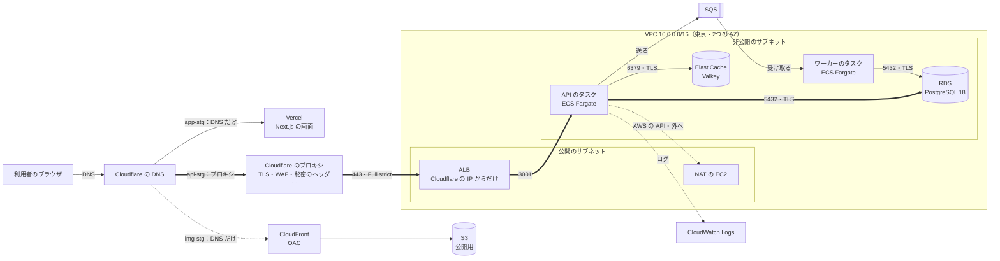

# 構成と、リクエストの通り道

開発手順書の S1-18。staging で、ブラウザで URL を開いてから RDS に届くまでの流れを書く。production も同じ形で、ホスト名だけが違う（`api-stg.` → `api.` のように `-stg` がなくなる）。

## 図



太い線（`==>`）は、画面が API を呼ぶときに通る道。

## ホスト名

| ホスト名 | 中身 | Cloudflare のプロキシ | 証明書 |
| --- | --- | --- | --- |
| `app-stg.sento-stamprally.com` | Vercel（画面） | オフ（DNS だけ） | Vercel |
| `api-stg.sento-stamprally.com` | Cloudflare → ALB → API | **オン** | ブラウザ〜Cloudflare：Cloudflare。Cloudflare〜ALB：ACM（東京） |
| `img-stg.sento-stamprally.com` | CloudFront → S3 | オフ（DNS だけ） | ACM（us-east-1） |

ホスト名を1段（`api-stg.`）にしているのは、Cloudflare の無料の証明書が、サブドメインを1段しか守らないため（`api.stg.` だと TLS の接続に失敗する）。

## 画面を開いてから RDS に届くまで

トップページの「API の状態」は、ブラウザから `GET /readyz` を呼ぶ。そのときの流れ。

1. **画面を取ってくる**：ブラウザが `app-stg.sento-stamprally.com` を Cloudflare の DNS に聞く。CNAME で Vercel の場所が返り、Vercel から画面（HTML・JavaScript）が届く。
2. **API の場所を知る**：画面の JavaScript は、ビルドのときに入れた `NEXT_PUBLIC_API_URL`（`https://api-stg.sento-stamprally.com`）に `fetch` する（`apps/web/src/api/client/client.ts`）。
3. **CORS の確認**：画面と API はホスト名（オリジン）が違う。ブラウザは、API の返事に `Access-Control-Allow-Origin: https://app-stg.sento-stamprally.com` があるときだけ、結果を画面に渡す。API は `WEB_ORIGIN` に書いたオリジンだけを許す（ADR-003）。
4. **Cloudflare**：`api-stg` はプロキシがオンなので、DNS は Cloudflare の IP を返す。ブラウザとの TLS は Cloudflare の証明書で終わる。Cloudflare は WAF を通したあと、**秘密のヘッダー**（`x-origin-verify`）を付けて、ALB に新しく TLS でつなぐ（Full strict：ALB の証明書を確かめる）。
5. **ALB**：セキュリティグループで、**Cloudflare の IP の範囲からの 443 だけ**を受ける。リスナーのルールで、秘密のヘッダーがあれば API に転送し、なければ 403 を返す（Cloudflare を通らない直接のアクセスを止める。ADR-013・ADR-024）。
6. **API のタスク**：ALB から 3001 番で受ける（`sg-api` は `sg-alb` からだけ通す）。リクエストごとに**相関 ID**（`X-Correlation-Id`）を決め、返事のヘッダーとログに入れる。
7. **RDS**：`/readyz` は、RDS（5432）に実際に問い合わせてから 200 を返す（`apps/api/src/index.ts` の `readinessChecks`。今は DB だけで、Valkey はまだ見ていない）。RDS とは TLS でつなぎ、RDS の証明書を、イメージに入れた RDS の CA で確かめる（`sslmode=verify-full`）。ALB のヘルスチェックは、DB を見ない `/healthz` を使う。
8. **ログ**：API は1つのリクエストを1行の JSON で標準出力に書く。ECS がそれを CloudWatch Logs の `/ecs/yumeguri-staging/api` に送る。

画像（`img-stg`）だけは別の道で、CloudFront が S3 から取ってくる。S3 は CloudFront からだけ読める（OAC）。

## 相関 ID で、1つのリクエストを追いかける

利用者から「エラーが出た」と言われたら、画面に出た相関 ID（または、開発者ツールの返事のヘッダーの `x-correlation-id`）で、API のログを探す。

1. CloudWatch → ログ → **Logs Insights** を開く（リージョンは東京）
2. ロググループ `/ecs/yumeguri-staging/api` を選び、期間を広めにする
3. 次の問い合わせを実行する

```
fields @timestamp, level, msg, path, status, correlationId
| filter correlationId = "ここに相関 ID を貼る"
| sort @timestamp asc
```

2026-11-16 に、ブラウザで見た相関 ID（`14ef338c-…`）で `/readyz` の 200 のログが1行見つかり、時刻も秒まで一致した。

## デプロイの道

コードの変更は、ブラウザの道とは別に、GitHub Actions から入る（ADR-026）。

1. `main` にマージ → CI が成功する
2. CD が OIDC でデプロイ用のロールを引き受ける（アクセスキーは置かない）
3. イメージを ECR に押し上げる
4. staging が動いていれば、DB のユーザーの作成 → マイグレーション → API・ワーカーの入れ替え
5. タグを SSM のパラメータに記録する（次に up したときも、このイメージで作られる）

画面（Vercel）は、`main` へのマージで Vercel が自分でビルドして出す。

## 関係する ADR

- ADR-001（画面は Vercel）・ADR-002（ECS Fargate・ARM）・ADR-003（Cookie と CORS）
- ADR-011（RDS）・ADR-012（SQS・ElastiCache）・ADR-013（外への通信と、ALB の守り方）
- ADR-022（アカウントの分け方・使うときだけ作る）・ADR-024（Cloudflare と CloudFront）・ADR-026（staging の CD）
