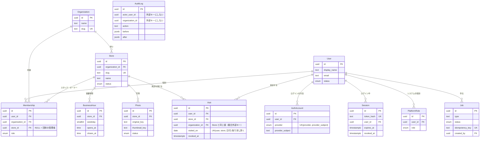

# ERD v0.1

開発手順書の S0-13。v0.1 で使う12の表だけを書く。v0.2 以降の表（スタンプ・特典など）は、使うステップで足す。

## 共通のルール

- **主キー**：`id uuid`、**UUID v7**（時刻順に並ぶので、索引が散らばりにくい）。PostgreSQL 18 には `uuidv7()` の関数があるので、DB の初期値で作る。連番の ID は使わない（要件定義書 8.1）
- **時刻**：`timestamptz`（UTC で保存して、表示するときに JST にする）。どの表にも `created_at`・`updated_at` がある（AuditLog は追記だけなので `created_at` だけ）
- **名前**：表の名前は Prisma のモデル名のまま（`"User"` のように大文字から始まる）。列の名前は `snake_case`（Prisma では `@map` で対応させる）
- **状態の列**：PostgreSQL の enum 型にする（Prisma の `enum`）。決まった値以外は DB が受け付けない
- **Prisma で書けない制約**（部分インデックス・`NULLS NOT DISTINCT`・CHECK 制約）は、SQL だけのマイグレーションで足す。下の表で **[SQL]** と付けたもの

## 団体 ID（organization_id）を持つ表

**v0.1 から本番と同じ分け方にする。** あとから足すと、すべての検索と権限の判定を直すことになる。

| 表 | organization_id | 理由 |
| --- | --- | --- |
| Organization | （自分自身） | テナントそのもの |
| Store | **持つ** | 銭湯はどれか1つの団体に属する。テナントの境界の起点 |
| Membership | **持つ** | 「どの団体で、何の役割か」を表す表。権限の判定に必須 |
| Visit | **持つ（わざと重複させている）** | 下の「正規化の確認」を参照 |
| AuditLog | 持つ（NULL を許す） | 団体の管理者が、自分の団体のログだけを見られるように。システム全体の操作は NULL |
| BusinessHour・Photo | 持たない | 必ず Store を通して読み書きする（Store で団体を絞り込んでから JOIN する） |
| User・AuthAccount・Session | 持たない | 利用者は団体をまたいで、いろいろな団体の銭湯に行く。どこかの団体には属さない |
| PlatformRole | 持たない | システム全体の役割（団体の外） |
| Job | 持たない | 作った人（`created_by`）が持ち主。対象のデータ（写真など）は `payload` の ID から、団体を確認してからたどる |

## 表の定義

`NN` = NOT NULL（NULL を許さない）。書いていない列は NULL を許す。

### User（利用者）

| 列 | 型 | NN | 初期値 | 制約・メモ |
| --- | --- | --- | --- | --- |
| id | uuid | ✓ | `uuidv7()` | 主キー |
| display_name | text | ✓ | | |
| email | text | | | Google から受け取る。**一意にしない**（本人を表すのは AuthAccount。メールアドレスは変わることがある） |
| status | enum `UserStatus`（active / suspended / deleted） | ✓ | `active` | |
| deleted_at | timestamptz | | | 退会した日時。30日後に匿名化 |
| created_at / updated_at | timestamptz | ✓ | `now()` | |

### AuthAccount（ログインの方法）

| 列 | 型 | NN | 初期値 | 制約・メモ |
| --- | --- | --- | --- | --- |
| id | uuid | ✓ | `uuidv7()` | 主キー |
| user_id | uuid | ✓ | | 外部キー → User（`ON DELETE CASCADE`） |
| provider | enum `AuthProvider`（google） | ✓ | | v0.1 は google だけ。LINE などを足すときは、enum に値を足すマイグレーションを書く |
| provider_subject | text | ✓ | | ID トークンの `sub`（Google の中で、その人を表す変わらない値） |
| created_at / updated_at | timestamptz | ✓ | `now()` | |

- **一意**：`(provider, provider_subject)`（同じ Google アカウントで、2人の User が作られないように）
- **索引**：`user_id`

### Session（ログイン中の状態）

| 列 | 型 | NN | 初期値 | 制約・メモ |
| --- | --- | --- | --- | --- |
| id | uuid | ✓ | `uuidv7()` | 主キー |
| token_hash | text | ✓ | | **Cookie に入れるランダムな値の SHA-256**。一意。値そのものは DB に置かない（DB が漏れても、セッションを乗っ取られないように） |
| user_id | uuid | ✓ | | 外部キー → User（`ON DELETE CASCADE`） |
| expires_at | timestamptz | ✓ | | 最長30日 |
| last_seen_at | timestamptz | ✓ | `now()` | |
| revoked_at | timestamptz | | | ログアウトした日時 |
| user_agent | text | | | |
| ip_hash | text | | | IP アドレスはハッシュにして保存する |
| created_at / updated_at | timestamptz | ✓ | `now()` | |

- **一意**：`token_hash`
- **索引**：`user_id`（「すべての端末からログアウト」で使う）、`expires_at`（期限切れを消す処理で使う）

### Organization（団体）

| 列 | 型 | NN | 初期値 | 制約・メモ |
| --- | --- | --- | --- | --- |
| id | uuid | ✓ | `uuidv7()` | 主キー |
| name | text | ✓ | | |
| slug | text | ✓ | | URL に使う短い名前。**一意** |
| created_at / updated_at | timestamptz | ✓ | `now()` | |

### Membership（団体・銭湯での役割）

| 列 | 型 | NN | 初期値 | 制約・メモ |
| --- | --- | --- | --- | --- |
| id | uuid | ✓ | `uuidv7()` | 主キー |
| user_id | uuid | ✓ | | 外部キー → User（`ON DELETE CASCADE`） |
| organization_id | uuid | ✓ | | 外部キー → Organization |
| store_id | uuid | | | 外部キー → Store（**`(store_id, organization_id)` → Store の `(id, organization_id)` の複合外部キー**）。団体の管理者は NULL |
| role | enum `MembershipRole`（staff / owner / org_admin） | ✓ | | |
| created_at / updated_at | timestamptz | ✓ | `now()` | |

- **一意 [SQL]**：`(user_id, organization_id, store_id, role)` を **`NULLS NOT DISTINCT`** で。PostgreSQL は普通、NULL どうしを「別の値」とみなす。そのため、団体の管理者（store_id が NULL）の行が何件でも入ってしまう。`NULLS NOT DISTINCT`（PostgreSQL 15 から）を付けると、NULL どうしも同じ値として扱われる
- **CHECK [SQL]**：`(role = 'org_admin') = (store_id IS NULL)`（団体の管理者には銭湯がなく、スタッフ・オーナーには必ず銭湯がある）
- **複合外部キーの理由**：「A 団体の役割なのに、B 団体の銭湯を指している」行を、DB が受け付けないようにする
- **索引**：`user_id`（ログインした人の役割を引く）、`organization_id`
- Store の表は S2-01 で作るので、`store_id` の外部キーは S2-01 のマイグレーションで足す

### PlatformRole（システム全体の役割）

| 列 | 型 | NN | 初期値 | 制約・メモ |
| --- | --- | --- | --- | --- |
| id | uuid | ✓ | `uuidv7()` | 主キー |
| user_id | uuid | ✓ | | 外部キー → User（`ON DELETE CASCADE`） |
| role | enum `PlatformRoleName`（platform_admin） | ✓ | | |
| created_at / updated_at | timestamptz | ✓ | `now()` | |

- **一意**：`(user_id, role)`

### AuditLog（監査ログ、追記だけ）

| 列 | 型 | NN | 初期値 | 制約・メモ |
| --- | --- | --- | --- | --- |
| id | uuid | ✓ | `uuidv7()` | 主キー |
| actor_user_id | uuid | | | 操作した人。システムの処理なら NULL。**外部キーにしない**（下を参照） |
| organization_id | uuid | | | どの団体の操作か。外部キーにしない |
| action | text | ✓ | | 例：`store.update`、`visit.revoke` |
| target_type | text | ✓ | | 例：`Store` |
| target_id | uuid | | | |
| before / after | jsonb | | | 変更の前と後 |
| reason | text | | | 個人情報を見たときなどの理由 |
| correlation_id | text | ✓ | | リクエストの ID（ログと結び付ける） |
| ip_hash | text | | | |
| created_at | timestamptz | ✓ | `now()` | `updated_at` はない（書き換えないため） |

- **権限 [SQL]**：アプリ用の DB ユーザーから `UPDATE`・`DELETE` を取り上げる（S1-07）
- **外部キーにしない理由**：ログは、対象のデータが消えたあとも残す必要がある。外部キーにすると、ログがあるせいでデータを消せなくなったり、ログが一緒に消えたりする。`target_id` は、表によって指す先が変わるので、もともと外部キーにできない
- **索引**：`(organization_id, created_at)`（団体のログを新しい順に見る）、`(target_type, target_id)`（あるデータの変更の履歴を見る）

### Store（銭湯）

| 列 | 型 | NN | 初期値 | 制約・メモ |
| --- | --- | --- | --- | --- |
| id | uuid | ✓ | `uuidv7()` | 主キー |
| organization_id | uuid | ✓ | | 外部キー → Organization |
| slug | text | ✓ | | 公開ページの URL。**一意** |
| name | text | ✓ | | |
| name_kana | text | | | **わざと NULL を許す**。v0.2 で「任意 → 必須」を無停止の4段階で変える練習をする（要件定義書 9.5） |
| description | text | | | |
| prices | jsonb | | | 例：`{"adult": 600, "child": 200}` |
| status | enum `StoreStatus`（draft / published / closed） | ✓ | `draft` | 公開ページに出るのは published だけ |
| deleted_at | timestamptz | | | 論理削除 |
| created_at / updated_at | timestamptz | ✓ | `now()` | |

- **一意**：`slug`、`(id, organization_id)`（Membership と Visit の複合外部キーの参照先にするため。id だけで一意なので、意味としては同じ）
- **索引**：`(organization_id, status)`
- v0.1 では、`area_id`・`search_text` は作らない（S2-03b で足す）

### BusinessHour（営業時間）

| 列 | 型 | NN | 初期値 | 制約・メモ |
| --- | --- | --- | --- | --- |
| id | uuid | ✓ | `uuidv7()` | 主キー |
| store_id | uuid | ✓ | | 外部キー → Store（`ON DELETE CASCADE`） |
| weekday | smallint | ✓ | | 0（日）〜6（土）。**CHECK [SQL]**：`weekday BETWEEN 0 AND 6` |
| opens_at | time | ✓ | | 例：`15:00` |
| closes_at | time | ✓ | | 例：`01:00`（翌日の1時） |
| created_at / updated_at | timestamptz | ✓ | `now()` | |

- **CHECK [SQL]**：`opens_at <> closes_at`
- **索引**：`(store_id, weekday)`
- 1日に複数の時間帯を持てる（同じ曜日の行を2つ入れる）。**行がない曜日は定休日**
- 要件定義書の `crosses_midnight`（日付をまたぐか）は **持たない**（下の「正規化の確認」を参照）

### Photo（写真）

| 列 | 型 | NN | 初期値 | 制約・メモ |
| --- | --- | --- | --- | --- |
| id | uuid | ✓ | `uuidv7()` | 主キー |
| store_id | uuid | ✓ | | 外部キー → Store（`ON DELETE CASCADE`） |
| original_key | text | ✓ | | 非公開のバケットの、アップロードされた元のファイルの S3 のキー |
| thumbnail_key | text | | | 公開用のバケットの、加工後のファイルの S3 のキー。加工が終わるまで NULL |
| status | enum `PhotoStatus`（uploading / processing / ready / failed） | ✓ | `uploading` | |
| sort_order | integer | ✓ | `0` | 表示の順番 |
| width / height | integer | | | 加工後に入れる |
| created_at / updated_at | timestamptz | ✓ | `now()` | |

- **CHECK [SQL]**：`status <> 'ready' OR thumbnail_key IS NOT NULL`（「準備完了なのにサムネイルがない」行を作らせない）
- **索引**：`(store_id, sort_order)`
- 保存するのは **S3 のキーだけ**（バケット名は環境ごとの設定で持つ）

### Visit（来訪）

| 列 | 型 | NN | 初期値 | 制約・メモ |
| --- | --- | --- | --- | --- |
| id | uuid | ✓ | `uuidv7()` | 主キー |
| user_id | uuid | ✓ | | 外部キー → User |
| store_id | uuid | ✓ | | 複合外部キー `(store_id, organization_id)` → Store の `(id, organization_id)` |
| organization_id | uuid | ✓ | | 店から決める（利用者が送ってきた値は使わない） |
| visited_on | date | ✓ | | **JST の日付**（サーバーの時刻は UTC なので、アプリで JST に直して入れる） |
| source | enum `VisitSource`（qr / posted_qr / manual） | ✓ | | v0.1 は qr だけ使う |
| created_by | uuid | | | 外部キー → User。手動のときのスタッフ |
| revoked_at | timestamptz | | | 取り消した日時 |
| created_at / updated_at | timestamptz | ✓ | `now()` | |

- **部分一意インデックス [SQL]**：`(user_id, store_id, visited_on) WHERE revoked_at IS NULL`。同じ人が、同じ日に、同じ銭湯に2回チェックインできない。取り消した来訪は数えないので、取り消したあとにもう一度チェックインできる
- **CHECK [SQL]**：`source <> 'manual' OR created_by IS NOT NULL`（手動なら、誰が付けたかが必ず残る）
- **索引**：`(store_id, visited_on)`（レポート用）、`(user_id, visited_on)`（自分の来訪の一覧）
- **同時に送られた場合**：アプリで「もうあるか」を先に調べるのではなく、**一意制約に任せる**。調べてから入れる方法だと、2つのリクエストが同時に「まだない」と判断して、両方とも入れてしまう。一意制約の違反は「本日はチェックイン済み」として 200 を返す（要件定義書 9.4）

### Job（非同期の処理）

| 列 | 型 | NN | 初期値 | 制約・メモ |
| --- | --- | --- | --- | --- |
| id | uuid | ✓ | `uuidv7()` | 主キー |
| type | text | ✓ | | 例：`photo.process` |
| status | enum `JobStatus`（pending / queued / running / retry_wait / succeeded / failed / dead / cancelled） | ✓ | `pending` | 状態の移り方は要件定義書 9.3 |
| progress | smallint | ✓ | `0` | **CHECK [SQL]**：`progress BETWEEN 0 AND 100` |
| payload | jsonb | ✓ | | 例：`{"photo_id": "..."}` |
| result_key | text | | | 結果のファイルの S3 のキー |
| attempts | integer | ✓ | `0` | |
| max_attempts | integer | ✓ | `5` | **CHECK [SQL]**：`attempts <= max_attempts` |
| last_error | text | | | |
| idempotency_key | text | ✓ | | **一意**。同じジョブが2回作られないように（例：`photo.process:<photo_id>`） |
| created_by | uuid | | | 外部キー → User。システムが作ったら NULL |
| started_at / finished_at | timestamptz | | | |
| created_at / updated_at | timestamptz | ✓ | `now()` | |

- **索引**：`(status, created_at)`

## ER 図

## 正規化の確認（Day 55）

同じ情報を2か所に持つと、片方だけ更新されて食い違う。v0.1 の表を見直した結果は次のとおり。

| 場所 | 判断 | 理由 |
| --- | --- | --- |
| Visit の `organization_id` | **わざと持つ** | Store から分かる値だが、① すべての検索で団体 ID を必須にするルール（要件定義書 8.1）を、JOIN なしで守れる ② 団体ごとの集計（v0.2 のレポート）が速い。食い違いは、**複合外部キー**（`(store_id, organization_id)` → Store）で DB が防ぐ |
| Membership の `organization_id` | **わざと持つ** | 団体の管理者は store_id がないので、団体はこの列でしか分からない。スタッフ・オーナーの行は、Visit と同じく複合外部キーで食い違いを防ぐ |
| BusinessHour の `crosses_midnight` | **持たない**（要件定義書から変える） | `closes_at < opens_at` なら日付をまたぐ、と計算で分かる。列にすると、時刻だけ直して、こちらを直し忘れることが起きる |
| User の `email` | 1か所だけ | AuthAccount には持たせない |
| Store の `status = closed` と `deleted_at` | 別の意味 | closed は「閉業した」（公開ページに閉業と出す）。deleted_at は「データとして消した」（どこにも出さない） |

## チェックインのときの、表の読み書きの順番

（完了の条件：これを ERD を見ながら説明できる）

1. **Session** を読む：Cookie の値をハッシュにして `token_hash` で探す → 期限切れでなく、取り消されていないか → `user_id` が分かる
2. **User** を読む：`status` が active か
3. QR のトークンを検証する（署名・期限・店 ID）。DB は使わない
4. **ElastiCache**：nonce を `SET NX`（値は利用者の ID。別の人が使用済みなら弾く。同じ人の二度押しなら先に進める。[API v0.1](api.md) の 12）
5. **Store** を読む：トークンの店 ID で探す → published で、消されていないか → **`organization_id` が分かる**
6. **Visit** を書く：`user_id`（1から）、`store_id`、`organization_id`（5から）、`visited_on`（今の JST の日付）、`source = qr`
7. 一意制約の違反なら「本日はチェックイン済み」として 200 を返す
